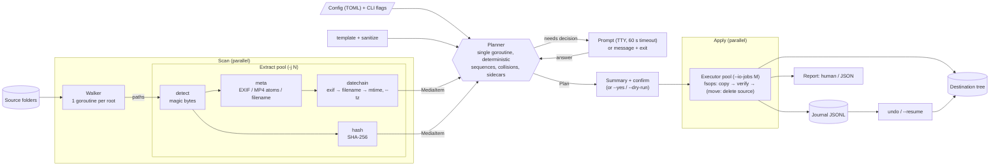

# media-organizer — Project Plan

A Go CLI that scans folders of photos and home movies, reads their embedded metadata (EXIF, QuickTime/MP4 atoms), and copies, or, optionally, moves them into a configurable folder tree with optional renaming.

- **Repo:** `CaffeineOgre/media-organizer` (sibling of `file-deduper`, `folder-sync`)
- **Language:** Go (pure Go, single static binary, no cgo, no external tools)
- **Platforms (v1):** Linux, macOS, Windows (amd64 + arm64)
- **Plan status:** Draft v0.3 (2026-10-21). Items marked **OPEN** must be settled before the tasks that depend on them begin.

---

## 1. Decisions Record

| # | Decision | Source |
|---|---|---|
| D1 | Go, pure-Go dependencies only; no exiftool/ffprobe, no cgo | CaffeineOgre |
| D2 | New repo `media-organizer` | CaffeineOgre |
| D3 | Default operation is **copy**; **move** only with an explicit flag | CaffeineOgre |
| D4 | Date source chain is configurable; default `exif → filename → mtime` | CaffeineOgre |
| D5 | Identical-content collision policy is configurable; default **skip & report**; alternatives: keep both (suffix), send to duplicates folder | CaffeineOgre |
| D6 | Sidecars/pairs (`.xmp`, `.aae`, `.thm`, Live Photo HEIC+MOV, RAW+JPEG) grouped only with an opt-in flag | CaffeineOgre |
| D7 | Filenames use a configurable template; default sequence is per day, ordered by capture time, `{seq:4}` | CaffeineOgre |
| D8 | v1 layout schemes: **date-based** (YYYY/MM/DD, YYYY/MM, YYYY, …) and **by media type** (Photos/Videos/Raw) | CaffeineOgre |
| D9 | EXIF times without a timezone are treated as camera-local wall clock; `OffsetTime*` tags are used when present; no conversion | CaffeineOgre |
| D10 | When required input is missing or ambiguous, the CLI **asks** (TTY) or **fails with a clear error** (no TTY). It never silently picks a layout | Requirement |
| D11 | **`undo` command**: every apply writes a journal; `media-organizer undo <journal>` reverses it, after checking that each destination file is unchanged (by hash) | CaffeineOgre |
| D12 | **Move deletes the source only after the copy is verified** (hash of the written file equals the source hash, after fsync). If verification fails, the source is kept and the bad copy is removed. Same-device moves use an atomic rename (no copy, so nothing to verify) | CaffeineOgre |
| D13 | **Schemes combine** in any order as path segments, e.g. `type,date-ym` → `Photos/2023/01`, `date-ym,type` → `2023/01/Photos` | CaffeineOgre |
| D14 | With no rename, files **keep their original name** (collision policy still applies) | CaffeineOgre |
| D15 | **Re-run sequence conflict** (new file sorts before existing numbered files for that day): prompt the user to choose append or renumber. With `--non-interactive`, no TTY, or a prompt timeout, print a message explaining the conflict and the flag that settles it (`--seq-conflict=append\|renumber`), then exit non-zero without changing anything | CaffeineOgre |
| D16 | Config file is **TOML** | CaffeineOgre |
| D17 | **`--tz <IANA zone>`** flag (also settable in config) | CaffeineOgre |
| D18 | Files dated from **mtime** are both flagged in the report/JSON **and** placed under an `Unverified/` subtree of the destination | CaffeineOgre |
| D19 | Duplicate detection is this tool's own Go implementation (size grouping + SHA-256); no reuse of `file-deduper` | CaffeineOgre |
| D20 | **Prompt timeout** defaults to **60 s** for every prompt; configurable with `--prompt-timeout` (and in config). On timeout: message + non-zero exit, no changes | CaffeineOgre |
| D21 | **`--tz` semantics:** EXIF times with no offset are read as being in that zone; UTC-only video times (QuickTime `mvhd`/`tkhd`) are converted to that zone for foldering and naming. **Without `--tz`, UTC-only video times are used as UTC** (no conversion); naive EXIF times stay camera-local (D9) | CaffeineOgre |

### Architect's proposals (accept or change in review)

| # | Proposal | Rationale |
|---|---|---|
| P1 | Two-phase **plan → apply**: always compute the full plan first, show a summary, require confirmation (or `--yes`) | Lets users review before touching files; makes dry-run free |
| P4 | Never overwrite: create with `O_EXCL`, write to a temp file in the destination dir, fsync, then atomic rename | Prevents clobbering and torn files |
| P5 | Default exclusions: hidden files, OS junk (`.DS_Store`, `Thumbs.db`, `desktop.ini`), and the destination tree if it sits inside a source | Idempotent, no self-ingest |
| P6 | Config location: `$XDG_CONFIG_HOME/media-organizer/config.toml` (Linux), `~/Library/Application Support/media-organizer/config.toml` (macOS), `%APPDATA%\media-organizer\config.toml` (Windows), overridable with `--config` | Platform conventions |
| P7 | `Unverified/` is a fixed name in v1; renaming it is a config key | Simple default, still adjustable |

## 2. Open Decisions (blocking)

None at present. New questions raised during implementation go here, each naming the tasks it blocks.

## 3. Architecture



| Component | Responsibility | Parallelism |
|---|---|---|
| `walk` | Recursive scan; skip symlinks (default), hidden, excluded paths; detect cycles if `--follow-symlinks` | One goroutine per source root |
| `detect` | Classify by **magic bytes** (not just extension): image / video / raw / sidecar / unknown | In extract pool |
| `meta` | Read capture time, offset, make/model, dimensions from EXIF (JPEG, TIFF, HEIC/HEIF, DNG, common RAW) and QuickTime/MP4 atoms (`mvhd`, `com.apple.quicktime.creationdate`) | Extract pool, `-j` default `GOMAXPROCS` |
| `datechain` | Apply the configured source order → `(time, source, confidence)`; apply `--tz` (D17, D21) | Pure function |
| `hash` | Streaming SHA-256 for duplicate detection and post-copy checks | Extract pool; separate I/O limiter |
| `template` | Parse and render folder and filename templates; validate at startup | Pure |
| `sanitize` | Make every rendered path component safe for all OSes (see §4) | Pure |
| `planner` | Group (sidecars), sort, assign sequences, resolve collisions, emit an ordered `Plan` | Single goroutine so output is deterministic |
| `fsops` | Safe copy/move/link primitives, same-device rename fast path, cross-device copy+verify | Executor pool, `--io-jobs` default 4 |
| `journal` | Append-only JSONL of planned and finished ops; drives `undo` and `--resume` | Single writer |
| `cli` | Commands, flags, interactive prompts, progress, reports | — |

**Commands (proposed):** `organize` (plan + apply), `plan` (dry run, writes plan file), `apply <planfile>`, `undo <journal>`, `inspect <file>` (show the metadata and date chain result).

**Undo (D11):** `undo <journal>` reads the journal in reverse. For each finished op it re-hashes the destination; if it matches, a copy is removed, a move is moved back to its original path (refusing to overwrite anything now at that path), and directories the run created are removed if empty. Mismatched or missing files are skipped and listed. `undo --dry-run` shows what would happen. Undo writes its own journal, so an undo can be inspected and resumed after interruption.

**Move (D12):** cross-device: copy to temp → fsync → hash check against source hash → atomic rename into place → fsync parent → journal "copied" → delete source → journal "done". If any step before the delete fails, the source stays and the temp/copy is removed. Same-device: atomic rename, journaled.

**Layouts (D13):** `--layout` takes a comma-separated list of presets and/or raw templates, joined as path segments in the given order. Files dated from mtime get `Unverified/` prepended (D18).

**Template tokens (proposed, final list in T0.4):** `{YYYY} {YY} {MM} {MMM} {DD} {hh} {mm} {ss}`, `{seq:N}`, `{type}` (Photos/Videos/Raw), `{ext}` (lowercased), `{orig}` (original stem), `{make}`, `{model}`, `{source}` (date source used). Presets: `date-ymd` = `{YYYY}/{MM}/{DD}`, `date-ym` = `{YYYY}/{MM}`, `date-y` = `{YYYY}`, `type` = `{type}`; rename preset `{YYYY}-{MM}-{DD}-{seq:4}.{ext}`; no rename = `{orig}.{ext}` with the original extension case kept (D14).

**Candidate pure-Go libraries (to be evaluated in T0.3):** `evanoberholster/imagemeta` (JPEG/HEIC/CR2/CR3/NEF/ARW/DNG), `dsoprea/go-exif/v3`, `rwcarlsen/goexif`, `abema/go-mp4`; CLI `spf13/cobra` or stdlib `flag`; prompts `charmbracelet/huh`; config `BurntSushi/toml` or `pelletier/go-toml/v2`.

## 4. Security Requirements (by default)

| ID | Requirement |
|---|---|
| S1 | **No overwrite, ever.** `O_EXCL` creation; collisions go through the policy, never clobber |
| S2 | **No path traversal.** Rendered paths are built from sanitized components and checked to resolve under the destination root (`filepath.Rel` + no `..` + no absolute/volume prefix). Metadata like `Model="../../etc"` is untrusted input |
| S3 | **Cross-OS safe names:** strip control chars, `/ \ : * ? " < > \|`, trailing dots/spaces; reject Windows reserved names (`CON`, `NUL`, `COM1`…); NFC-normalize Unicode; cap component length at 255 bytes; detect case-insensitive collisions (macOS/Windows) |
| S4 | **Symlinks not followed** by default; symlinked dirs not descended; `--follow-symlinks` opt-in with cycle detection. Destination writes refuse to pass through symlinks |
| S5 | **Hostile file parsing:** all parsers bounded (max bytes read per file, max IFD count/depth, max atom nesting), with a timeout and panic recovery per file; covered by fuzz tests |
| S6 | **Integrity:** post-write hash check; move deletes the source **only after the copy is verified** (D12); fsync file and parent dir; undo verifies hashes before reversing (D11) |
| S7 | **Least privilege:** no network access, no exec of external programs, no elevated privileges; new files never get wider permissions than the source; dirs created `0o755`/inherited ACLs |
| S8 | **Safe output:** sanitize filenames before printing (no terminal escape injection), matching `file-deduper` |
| S9 | **Interruption safety:** SIGINT/SIGTERM drain in-flight ops, leave no temp files, journal stays consistent; `--resume` continues |
| S10 | **Supply chain:** minimal pinned deps, `govulncheck` + `gosec` + `go mod verify` in CI, reproducible builds (`-trimpath`), SBOM, checksums and signed releases |
| S11 | **Resource limits:** bounded worker pools and memory; no full-file reads into RAM; file descriptor cap |

## 5. Sprint Plan

Conventions: each task is sized for one agent in one sitting (~½–1 day). **∥** = can run in parallel with others in the same sprint. Each task ships code, unit tests, and doc comments, and must pass `go vet`, `staticcheck`, `gosec`, and `go test -race`. Interfaces frozen in Sprint 0 are the contract between parallel agents; changing one requires an ADR update.

### Sprint 0 — Foundations (mostly sequential; gates everything else)

| ID | Task | Deps | Acceptance criteria |
|---|---|---|---|
| T0.1 | Scaffold repo: `go mod`, layout (`cmd/media-organizer`, `internal/{walk,detect,meta,datechain,hash,template,sanitize,planner,fsops,journal,config,cli}`), Makefile, `.golangci.yml`, LICENSE, README stub | — | `go build ./...` passes; empty packages compile |
| T0.2 | CI: GitHub Actions matrix (ubuntu/macos/windows × amd64/arm64 where available), race tests, lint, `govulncheck`, `gosec` | T0.1 | Green pipeline on an empty project |
| T0.3 | **Spike:** evaluate pure-Go metadata libraries against a sample corpus (JPEG, HEIC, DNG, CR3, NEF, ARW, MP4, MOV, 3GP, AVI); record coverage, license, maintenance, fuzz robustness → ADR-001 | T0.1 | ADR with chosen lib(s) and a format coverage table |
| T0.4 | ADR-002: template grammar, token list, and layout composition (D13, D14); ADR-003: CLI command/flag surface and prompt flow (D15, D20); ADR-005: journal format and undo semantics (D11, D12) | T0.1 | ADRs merged and reviewed by CaffeineOgre |
| T0.5 | Threat model (STRIDE) and secure-defaults ADR-004, mapping S1–S11 to owning tasks | T0.1 | Every S-item has an owning task and a test |
| T0.6 | Freeze core types and interfaces in `internal/model`: `MediaItem`, `DateResult{Time, Offset, Source, Confidence}`, `Extractor`, `PlanOp{Src, Dst, Kind, Group}`, `Plan`, `JournalEntry`, `Policy` enums | T0.3, T0.4 | Package compiles; godoc complete; signed off |
| T0.7 | Test corpus: generate synthetic fixtures (via a Go generator script: crafted EXIF/QuickTime headers, no personal photos), including malformed/hostile samples, Unicode names, reserved names | T0.1 | `testdata/` with manifest of expected metadata |

### Sprint 1 — Core components (fully parallel; each depends only on T0.6)

| ID | Task | Acceptance criteria |
|---|---|---|
| T1.1  | `walk`: concurrent multi-root walker; symlink policy (S4); include/exclude globs; hidden/junk filters; destination-inside-source exclusion; deterministic order option | Cycle test with `--follow-symlinks`; Windows junction test; 1M-entry synthetic tree bench |
| T1.2  | `hash`: streaming SHA-256 with buffer pool; size-first grouping helper; I/O limiter (D19) | Throughput bench; no file fully buffered |
| T1.3  | `meta/image`: EXIF via chosen lib → `DateTimeOriginal` > `CreateDate` > `DateTime`, `OffsetTime*`, `SubSecTime*`, Make/Model; bounded reads (S5); return naive vs offset-aware time distinctly so `--tz` can apply | Fixtures pass; 10-min fuzz clean; malformed files return error, no panic |
| T1.4  | `meta/video`: MP4/MOV/3GP atoms (`mvhd`/`tkhd` creation_time, 1904 epoch, UTC; Apple `creationdate` with offset; `©day`), zero/1904 dates treated as missing; AVI `IDIT` best effort; mark UTC-only times (D21) | Fixtures pass; fuzz clean |
| T1.5  | `meta/filename`: date parsers for common patterns (`IMG_20230102_123456`, `PXL_…`, `VID-20230102-WA0001`, `2023-01-02 12.34.56`, `Screenshot_…`), with year-range sanity check | Table test ≥ 30 patterns, false-positive guard (e.g., `IMG_1234`) |
| T1.6  | `template`: parser, validator (unknown tokens and missing `{ext}` are errors at startup), renderer, presets, comma-separated layout composition (D13), original-name default (D14) | Golden tests per preset and for combined layouts; fuzz the parser |
| T1.7  | `sanitize`: S2/S3 component and full-path safety, case-fold key for collision detection | Traversal and reserved-name table tests on all 3 OSes in CI |
| T1.8  | `config`: TOML loading (D16) from platform paths (P6), env overrides, flag precedence (flags > env > file > defaults), schema validation, `config init` writes an example | Precedence tests; unknown keys rejected |
| T1.9  | `fsops`: `CopyVerified`, `MoveVerified` (rename fast path on same device, else copy → verify hash → delete source only on match, per D12), `Hardlink` (optional), temp file + fsync + atomic rename, permission/mtime preservation, `O_EXCL` | Fault-injection tests (disk full, interrupted copy, read-only dest); no temp files left behind |
| T1.10 | `detect`: magic-byte sniffing for supported formats; extension/content mismatch reported | Fixture table incl. renamed files |

### Sprint 2 — Orchestration (parallel in two lanes)

**Lane A — engine**

| ID | Task | Deps | Acceptance criteria |
|---|---|---|---|
| T2.1 | `datechain` + `planner`: apply configurable chain (D4), camera-local semantics (D9), `--tz` (D17, D21), sorting, per-day sequence assignment (D7), re-run sequence-conflict detection that returns a decision request instead of guessing (D15), collision policies (D5) with hash compare, case-insensitive collision handling, mtime flag + `Unverified/` prefix (D18) | T1.2–T1.7 | Deterministic: same input → byte-identical plan; property tests; conflict surfaces as a typed error, never a silent choice |
| T2.2 | Sidecar/pair grouping (D6, opt-in): `.xmp/.aae/.thm`, Live Photo (HEIC/JPG + MOV, same stem and content-ID when available), RAW+JPEG; group shares one target stem | T2.1 | Group never split across folders; fixtures |
| T2.3 | `executor`: bounded pool, per-destination-dir mkdir dedupe, progress events, context cancellation (S9), error budget (`--max-errors`) | T1.9, T2.1 | Race-free under `-race`; SIGINT test leaves consistent state |
| T2.4 | `journal` + `undo` command + `--resume` (D11): JSONL with fsync per batch, recording source hash and per-op state (`planned`/`copied`/`verified`/`source-deleted`/`done`); undo runs in reverse, re-hashes each destination, skips and lists changed/missing files, never overwrites a reappeared source path, removes empty dirs it created, supports `--dry-run`, writes its own journal | T2.3 | Round-trip tests for copy and move: organize → undo → tree byte-identical to the original; undo interrupted mid-run resumes cleanly; tampered dest file is skipped, not deleted |

**Lane B — UX**

| ID | Task | Deps | Acceptance criteria |
|---|---|---|---|
| T2.5 | CLI commands and flags per ADR-003: `--layout`, `--rename`, `--template`, `--move`, `--link`, `--dup-policy`, `--date-chain`, `--sidecars`, `--tz`, `--seq-conflict`, `--non-interactive`, `--prompt-timeout`, `-j`, `--io-jobs`, `--dry-run`, `--yes`, `--json`; `undo` subcommand flags | T1.6, T1.8 | `--help` golden tests; invalid combos rejected; `--tz` rejects non-IANA zones |
| T2.6 | Interactive prompts (D10, D15): when layout/rename/op or a sequence conflict needs a decision and stdin is a TTY, prompt with presets and a live sample preview from the first N files. On `--non-interactive`, no TTY, or prompt timeout (D20, default 60 s), print what was needed and the flag that answers it, then exit non-zero with no changes made | T2.5 | Scripted TTY tests incl. timeout; non-interactive never prompts; exit codes documented |
| T2.7 | Plan summary and confirmation (P1): counts by action, undated/mtime-dated items, collisions, total bytes, free-space check on destination | T2.1, T2.5 | Snapshot tests; aborts cleanly on "no" |
| T2.8 | Reports: human output (sanitized, S8), `--json`, error report file | T2.5 | Schema test for JSON |
| T2.9 | `inspect` command: prints metadata, date chain steps, and the target path the file would get | T1.3–T1.6 | Golden output per fixture |

### Sprint 3 — Integration, hardening, performance (parallel)

| ID | Task | Deps | Acceptance criteria |
|---|---|---|---|
| T3.1  | End-to-end test suite: every preset × copy/move × dup policy × sidecars on/off, on all 3 OSes | Sprint 2 | CI matrix green |
| T3.2  | Fuzzing campaign: `go test -fuzz` for every parser, template, sanitizer; seed corpus committed; nightly CI fuzz job | Sprint 1 | ≥ 1h per target clean; crashes become regression tests |
| T3.3  | Security review against S1–S11 and threat model; hostile-corpus E2E (traversal names, huge IFD counts, zip-bomb-like atoms, symlink races) | Sprint 2 | Findings fixed or ADR'd |
| T3.4  | Performance: benchmarks on 100k-file synthetic set, SSD vs HDD vs network share; tune `-j`/`--io-jobs` defaults; profile memory | Sprint 2 | Documented throughput; RSS bounded independent of tree size |
| T3.5  | Filesystem edge cases: exFAT/FAT32 (camera cards: 2s mtime, no hardlinks), NTFS case-insensitivity, APFS normalization, long paths on Windows (`\\?\`) | Sprint 2 | Tests or documented limits |

### Sprint 4 — Docs and release (parallel)

| ID | Task | Acceptance criteria |
|---|---|---|
| T4.1 | README, usage guide, template reference, config reference, security notes, FAQ (timezones, undated files) | Reviewed by CaffeineOgre |
| T4.2 | Release pipeline: GoReleaser, cross-compiled binaries, checksums, SBOM, signing (cosign), `-trimpath` reproducible builds | Tagged `v0.1.0` artifacts verify |
| T4.3 | Man page and shell completions (bash/zsh/fish/PowerShell) | Generated in release |
| T4.4 | v1 acceptance: CaffeineOgre runs it on a real library copy with dry-run → apply → undo | Sign-off |

## 6. Parallelism Map

```
Sprint 0:  T0.1 → T0.2
              ├─ T0.3 ─┐
              ├─ T0.4 ─┼─► T0.6 ──► Sprint 1 (T1.1 … T1.10 all parallel)
              ├─ T0.5  │
              └─ T0.7 ─┘
Sprint 2:  Lane A: T2.1 → T2.2, T2.3 → T2.4
           Lane B: T2.5 → T2.6, T2.7, T2.8, T2.9
Sprint 3:  T3.1–T3.5 parallel
Sprint 4:  T4.1–T4.3 parallel → T4.4
```

Max useful concurrency: about 10 agents in Sprint 1, 2–4 in Sprint 2, 5 in Sprint 3.

## 7. Risks

| Risk | Impact | Mitigation |
|---|---|---|
| Pure-Go libs lack coverage for some RAW/video formats (D1) | Wrong or missing dates | T0.3 coverage table; filename/mtime fallback; `inspect` makes gaps visible |
| Camera clock or timezone wrong | Files in wrong day | D9 documented; `--tz` (D17) |
| QuickTime times are UTC while EXIF is local | Photos and videos from the same evening split across days | Prefer Apple `creationdate` (has offset); `--tz`; D21 |
| Data loss in move mode | Critical | Copy default (D3), delete only after verified copy (D12), journal + `undo` (D11) |
| Hostile media files | Crash or exploit | S5 bounds, fuzzing (T3.2), per-file recover |
| Sequence instability on re-runs | Confusing names | User decides via prompt or `--seq-conflict` (D15); deterministic planner |

## 8. Glossary

| Term | Meaning |
|---|---|
| ADR | Architecture Decision Record — short doc capturing one design decision and why |
| APFS / NTFS / exFAT / FAT32 | macOS, Windows, and camera-card filesystems with differing name, case, and timestamp rules |
| atom | A box in the MP4/QuickTime file structure (e.g., `mvhd` holds movie creation time) |
| cgo | Go's mechanism for calling C code; avoided here to keep a static, cross-compilable binary |
| CI | Continuous Integration (automated build/test on each change) |
| cosign | Tool for signing release artifacts |
| DNG / CR2 / CR3 / NEF / ARW | RAW photo formats (Adobe, Canon, Canon, Nikon, Sony) |
| EXIF | Exchangeable Image File Format — metadata embedded in photos (capture time, camera, etc.) |
| fsync | Forces written data to disk so it survives power loss |
| fuzzing | Feeding random/mutated input to code to find crashes |
| GoReleaser | Tool that builds and publishes Go release binaries |
| `gosec` / `govulncheck` / `staticcheck` | Go security linter / known-vulnerability scanner / static analyzer |
| HEIC / HEIF | High Efficiency Image format (default on iPhones) |
| IANA zone | Standard timezone name, e.g. `America/New_York`, as used by `--tz` |
| IFD | Image File Directory — a table of tags inside EXIF/TIFF data |
| JSONL | JSON Lines — one JSON object per line |
| Live Photo | Apple still image plus a short MOV clip, linked by name/content ID |
| magic bytes | Signature bytes at the start of a file identifying its true format |
| mtime | File's last-modified timestamp |
| NFC | Unicode normalization form; keeps visually identical names byte-identical |
| `O_EXCL` | File-open flag that fails if the file already exists — prevents overwrites |
| OffsetTime | EXIF tag holding the UTC offset of the capture time |
| SBOM | Software Bill of Materials — list of dependencies in a build |
| sidecar | Companion file holding edits/metadata for a media file (`.xmp`, `.aae`, `.thm`) |
| STRIDE | Threat-modeling checklist: Spoofing, Tampering, Repudiation, Info disclosure, DoS, Elevation |
| TOML | Tom's Obvious Minimal Language — the config file format |
| TTY | An interactive terminal; used to decide whether prompting is possible |
| XDG | Linux convention for config file locations (`$XDG_CONFIG_HOME`) |
